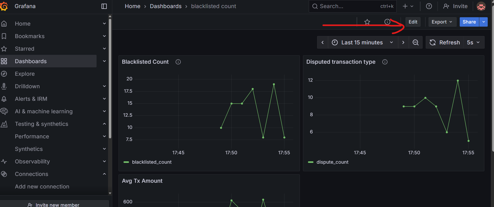

# Transaction Fraud Detection Using Rules (Only for Credit Cards)

## Field Description

- **Uniq_id**  
  Unique ID of each transaction.

- **Trans_type**  
  The type of transaction. Below are the simplified categories used for our project, derived from banking transaction types found across sources on the web:

  - **Dispute**  
    A transaction reversal that occurs when a customer disputes a charge with their bank or credit card company.

  - **Real_time_transaction**  
    For this demo, we consider all other transactions as real-time transactions, such as paying by credit card at a grocery store.

  - **Settlements**  
    The payer's bank debits the account, the payee's bank credits the account, and funds are transferred through the clearinghouse.

- **Amount**  
  The amount involved in the transaction.

- **Amount_crr**  
  Currency of the transaction, for example, INR, USD.

- **Account_holder_name**  
  Name of the account holder.

- **Card_presence**  
  Indicates whether the card was physically present during the transaction.

- **Merchant_category**  
  The merchant type where the transaction was made, e.g., gambling, flight tickets, grocery store.

- **Card_type**  
  The credit card company, such as Mastercard or Visa.

- **Card_id**  
  Last 4 digits of the credit card number, used for identification. Banks generate a new card_id every 6 to 12 months. The same card_id can be shared by multiple people since only the last 4 digits are used.

- **Account_id**  
  Unique account ID for the customer.

- **Account_blacklisted**  
  Indicates if the account is blacklisted.

- **Rules_triggered**  
  Specifies which rule(s) got triggered in our rule-based fraud detection system.

- **Rules_explanation**  
  Explanation of why a particular rule was triggered to track the reason for flagging the transaction.

- **Decision**  
  The system's verdict on the transaction — whether it was accepted or rejected.

## How to Run the Code

To run the project, copy the entire project folder which includes:

1. `App.ipynb`  
2. `Docker-compose.yml`  
3. `requirements.txt`

# Real-Time Problem Statement: The Battle Against Credit Card Fraud

Imagine the life of *Akira*, a young professional living in Tokyo. Every day, Akira uses his credit card conveniently to pay for groceries, dining, travel, and shopping. One morning, Akira checks his mobile banking app and to his horror, he notices multiple suspicious transactions amounting to thousands of dollars — transactions he never made!

Akira’s bank immediately freezes his card and launches an investigation. But how did this happen? Why was the fraud not detected before these transactions were approved? What if the bank's fraud detection system was smarter and quicker?

## The Challenge Banks Face Every Second

Banks and payment companies process **millions of credit card transactions every day**, and hidden within them may be fraudulent transactions by criminals trying to steal money illegally.

- How do banks distinguish between **real purchases** and **fraudulent activity** in real-time?
- What happens if the fraud detection system rejects legitimate transactions, frustrating honest customers?
- Conversely, what if it misses suspicious transactions, causing financial losses?

To solve this, banks rely on **fraud detection systems** that use a combination of advanced **rule-based checks**, machine learning, and statistics to quickly analyze every transaction, flag suspicious ones, and prevent fraud — all while minimizing inconvenience to genuine users.

## The Journey of This Project: Building a Real-Time Fraud Detector

In this project, you step into the shoes of data engineers and software developers tasked to build a **first-level fraud detection system** specialized for credit card transactions.

You will:

- Simulate real-world credit card transactions with random but realistic data.
- Implement **rule-based fraud detection** that automatically flags suspicious transactions — for example, large amounts over $100 or transactions from blacklisted accounts.
- Develop a system that processes and stores transaction details continuously and makes immediate decisions to protect users like Akira.
- Understand the complexities of data generation, real-time processing, and database interaction with PostgreSQL.

## Why This Matters

Every line of code you write helps **secure millions of users’ money** every day. Behind every app notification about a blocked transaction, there is a complex system working tirelessly to protect against fraud.

By the end of this session, you’ll not only understand how such systems work but also be equipped to contribute to real-world solutions fighting financial crime.

Would you like me to help frame the specific learning objectives or discussion points to integrate this story seamlessly into your session?

This story creates empathy with a relatable victim, explains the broader challenge in the banking sector, and clearly connects it to the project’s tasks and impact — which is an engaging way to motivate students to learn and participate.