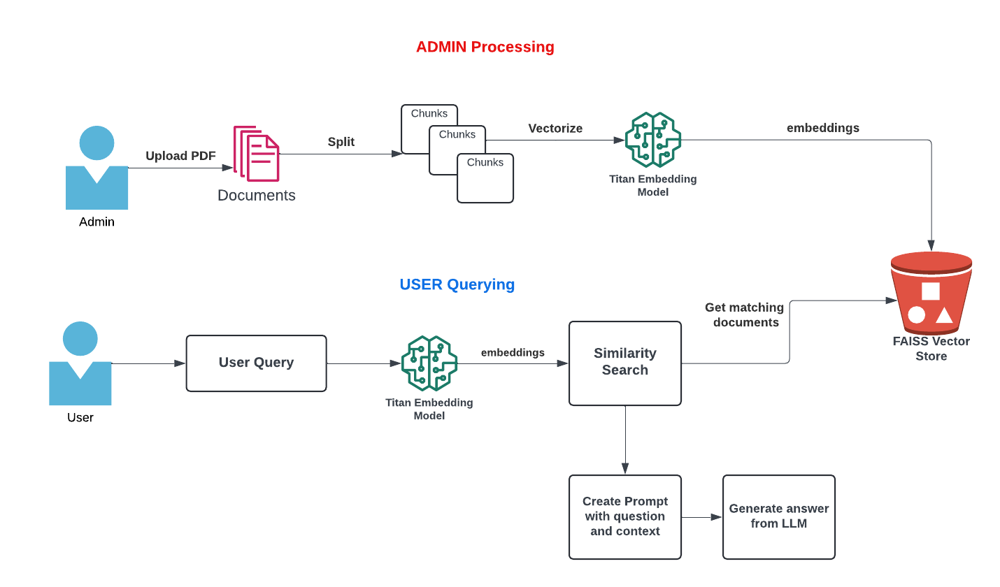

# Chat With PDF - Generative AI App

**Built With:**  
🔹 Amazon Bedrock, Langchain, Python, Docker, Amazon S3  
**Models:**  
- amazon.titan-embed-text-v2:0  
- amazon.titan-text-premier-v1:0

---

## Overview

- **Admin App:**  
  - Upload PDF, split text into chunks  
  - Create FAISS vector index using Titan Embeddings  
  - Upload index to S3

- **User App:**  
  - Download FAISS index from S3  
  - Use RetrievalQA to answer user queries with context



---

## Docker Commands

**Admin:**
```bash
docker build -t pdf-reader-admin .
docker run -e BUCKET_NAME=<YOUR S3 BUCKET NAME> -v ~/.aws:/root/.aws -p 8083:8083 -it pdf-reader-admin
```

**User:**
```bash
docker build -t pdf-reader-client .
docker run -e BUCKET_NAME=<YOUR S3 BUCKET NAME> -v ~/.aws:/root/.aws -p 8084:8084 -it pdf-reader-client
```

---

## Local Setup
Use the .env file to specify the s3 bucket name
```bash
# python3 -m venv venv && source venv/bin/activate
# pip install virtualenv

sudo apt update && sudo apt install docker-compose
docker-compose up --build
docker-compose down
```

---

*Note: The volume mount (-v ~/.aws:/root/.aws) is needed locally; in ECS/EKS, use IAM roles.*
```